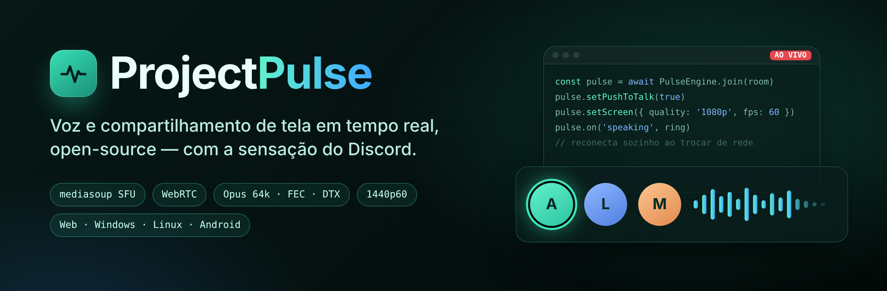

<p align="center">
  
</p>

<p align="center">
  <b>Canais de voz, chamadas e transmissão de tela com qualidade de Discord — no seu próprio servidor.</b><br>
  O motor de tempo real que roda o <a href="https://projectclub.shardweb.app">Project Club</a>, aberto para a comunidade.
</p>

<p align="center">
  
  
  
  
  
</p>

---

## O que é

**ProjectPulse** é um sistema completo de voz e vídeo em tempo real: um **servidor SFU** (Selective Forwarding Unit) baseado em [mediasoup](https://mediasoup.org), um **SDK para navegador e Electron**, um **SDK nativo para Android** e as peças de infraestrutura (TURN, TLS, deploy) para colocar tudo no ar numa VM comum.

Ele nasceu dentro do Project Club para substituir provedores pagos (Agora, GetStream) por algo próprio, sem limite de minutos e com controle total — e foi construído olhando o que os melhores projetos open-source fazem (mediasoup-demo, LiveKit, Jitsi, Mumble, Galene, Vesktop).

## ✨ Destaques

### 🎙️ Voz
- **Opus 64 kbps** mono com **FEC**, **DTX** e **NACK** — voz limpa mesmo com perda de pacotes.
- **Apertar-pra-falar** (com atraso de soltura configurável) e **detecção de voz** com sensibilidade automática ou manual.
- **Supressão de ruído RNNoise** no navegador, com portão assistido pela probabilidade de voz — corta teclado e respiração.
- **Anel de quem está falando** instantâneo (calculado localmente) e sincronizado para a sala.
- **Volume por pessoa até 200%**, volume separado para o áudio da transmissão.
- **Mudo e ensurdecido persistentes**, como no Discord; ensurdecer pausa o áudio no servidor e economiza banda.
- O microfone é publicado **já pausado** quando você está mudo — nada vaza.

### 🖥️ Compartilhamento de tela
- Presets **720p · 1080p · 1440p** a **5 / 15 / 30 / 60 fps**, trocáveis ao vivo.
- **Modo texto** (nitidez máxima para código e slides) e **modo movimento** (fluidez para jogos) via `contentHint` + `degradationPreference`.
- **Simulcast** em duas camadas — quem tem internet fraca recebe a versão menor em vez de congelar.
- **Áudio do sistema sem eco da chamada** no Windows (loopback que exclui o próprio app) e no **Linux via PipeWire**.
- Qualidade escolhida pelo **tamanho do vídeo na tela**; vídeos escondidos são pausados automaticamente.

### 🛡️ Permissões e moderação
- O servidor de mídia **confere as permissões no token**: falar, vídeo, palco (plateia × palestrante).
- **Silenciar / ensurdecer no servidor, mover e desconectar** membros, respeitando a hierarquia de cargos.
- **Limite de pessoas por canal** atômico (Redis/Lua), com exceção para quem pode mover membros.
- API de controle assinada (`POST /control`) para o backend agir na mídia em tempo real.

### 🔁 Conexão que não cai
- **Reconexão automática** com ICE restart; troca **Wi-Fi ⇄ 4G** recupera em cerca de 1 segundo.
- **Ping de sinalização** a cada 5 s — conexão morta é detectada antes do usuário perceber.
- Sem internet ou depois do PC dormir, a chamada **espera e volta**, em vez de desistir.
- **TURN** em UDP, TCP e **TLS (5349)**, com suporte a TURN na porta 443 para redes restritas.
- Servidor com **WebRtcServer** (portas fixas), recriação automática de worker e proteção contra reconexões em loop.

## 🧱 Arquitetura

```
 ┌──────────────┐   WebSocket (sinalização + JWT)   ┌───────────────────────────┐
 │  Navegador   │ ───────────────────────────────▶  │      ProjectPulse SFU      │
 │  / Electron  │ ◀═══════ RTP/RTCP (WebRTC) ═════▶ │  mediasoup · Node · Redis  │
 └──────────────┘                                   │  /ws  /health  /control    │
 ┌──────────────┐                                   └─────────────┬─────────────┘
 │ Android      │ ◀═══════ RTP/RTCP (WebRTC) ═════▶               │
 │ (Kotlin)     │                                         ┌───────┴───────┐
 └──────────────┘          redes restritas  ────────────▶ │ coturn (TURN) │
                                                          └───────────────┘
 ┌──────────────┐   POST /control (assinado)
 │ Seu backend  │ ─────────────────────────────▶ silenciar · expulsar · permissões
 └──────────────┘   emite JWT de sala com canSpeak / canVideo / role
```

| Peça | O que faz |
|---|---|
| `media-server/` | SFU mediasoup, sinalização WebSocket, API de controle, estatísticas, Docker Compose com coturn + Caddy (HTTPS automático) |
| `sdk/web/` | Motor do cliente para navegador e Electron: microfone, portão/PTT, tela, reconexão, reprodução com auto-cura |
| `sdk/android/` | Motor nativo Kotlin sobre `libmediasoup-android`, roteamento de áudio, foco de áudio, troca de rede |
| `desktop/` | Integrações Electron: áudio do sistema sem eco (Windows) e PipeWire/venmic (Linux) |
| `docs/` | Protocolo de sinalização, formato do token, API de controle, guia de deploy |

> **Status:** o código está sendo extraído do Project Club, onde já roda em produção. As pastas acima chegam aqui por etapas.

## 🚀 Começando (servidor)

Requisitos: uma VM Linux com IP público, Docker e um domínio (ou `seu-ip.sslip.io`).

```bash
git clone https://github.com/RiqueBitt/ProjectPulse
cd ProjectPulse/media-server
cp .env.example .env        # MEDIA_SERVER_SECRET, MEDIA_PUBLIC_IP, MEDIA_DOMAIN, TURN_SECRET
docker compose up -d --build
curl https://SEU_DOMINIO/health
```

Portas: `80,443/tcp` · `3478/udp+tcp` · `5349/tcp` · `40000-40999/udp+tcp` · `49152-49999/udp`.

Seu backend gera um **JWT** (assinado com `MEDIA_SERVER_SECRET`) por pessoa e sala:

```js
import jwt from 'jsonwebtoken';

const token = jwt.sign(
  { room: 'canal-123', uid: user.id, canSpeak: true, canVideo: true, role: 'speaker' },
  process.env.MEDIA_SERVER_SECRET,
  { expiresIn: '15m', jwtid: crypto.randomUUID() }
);
```

## 🧩 Usando no cliente (web) — prévia da API

```js
const pulse = new PulseEngine({ url: 'wss://SEU_DOMINIO/ws', token, iceServers });

pulse.onLocalSpeaking = (on) => ring(me, on);
pulse.onMediaUser     = (uid, on) => updateTiles(uid, on);

await pulse.join({ startMuted: false });
pulse.setPushToTalk(true);
pulse.setPttPressed(true);                            // tecla apertada
await pulse.setScreen(true, { quality: '1080p', frameRate: 60 });
await pulse.setScreenQuality({ quality: '720p', frameRate: 30 }); // ao vivo
pulse.setUserVolume('uid-42', 1.5);                   // 150%
```

A referência completa da API fica em `docs/`.

## 🗺️ Roadmap

- [x] SFU mediasoup com WebRtcServer, TURN/TLS e recriação de worker
- [x] Permissões no token e API de controle
- [x] Apertar-pra-falar, sensibilidade e RNNoise
- [x] Reconexão por mudança de rede
- [x] Áudio da tela sem eco (Windows) e PipeWire (Linux)
- [ ] Publicar `sdk/web` no npm
- [ ] Áudio interno na transmissão de tela do Android
- [ ] Supressão de ruído DeepFilterNet (opcional, alta qualidade)
- [ ] TURN na porta 443 via Caddy L4

## 🤝 Contribuindo

Issues e pull requests são bem-vindos. Antes de abrir um PR:

1. Rode os testes do servidor (`npm test` em `media-server/`) e o teste ponta a ponta de WebRTC.
2. Descreva o comportamento antes e depois.
3. Não copie código de projetos GPL/AGPL para os SDKs — eles precisam continuar usáveis em apps fechados.

## 📜 Licenças e créditos

O ProjectPulse se apoia no trabalho de muitos projetos open-source. A lista completa — projeto, link, licença e o que foi usado — está em [`THIRD_PARTY_NOTICES.md`](THIRD_PARTY_NOTICES.md). Destaques:

| Projeto | Licença | Uso |
|---|---|---|
| [mediasoup](https://github.com/versatica/mediasoup) / [mediasoup-demo](https://github.com/versatica/mediasoup-demo) | ISC | SFU, cliente WebRTC e padrões de encodings |
| [LiveKit](https://github.com/livekit/client-sdk-js) | Apache-2.0 | Presets de tela, adaptive stream, reconexão por rede |
| [lib-jitsi-meet](https://github.com/jitsi/lib-jitsi-meet) | Apache-2.0 | contentHint / degradationPreference por fps |
| [RNNoise](https://github.com/xiph/rnnoise) · [@jitsi/rnnoise-wasm](https://github.com/jitsi/rnnoise-wasm) | BSD-3 · Apache-2.0 | Supressão de ruído e probabilidade de voz |
| [web-noise-suppressor](https://github.com/sapphi-red/web-noise-suppressor) | MIT | Máquina de estados do portão de ruído |
| [venmic](https://github.com/Vencord/venmic) | MPL-2.0 | Áudio do sistema no Linux (sem modificações) |
| [coturn](https://github.com/coturn/coturn) · [Caddy](https://github.com/caddyserver/caddy) | BSD-3 · Apache-2.0 | TURN e HTTPS |

Inspiração (ideias, sem código copiado): Vesktop, Equibop, Element Call, Spacebar, Revolt, Janus, eduMEET, Mumble e Galene.

---

<p align="center">Feito com 💚 pela equipe do <b>Project Club</b></p>
